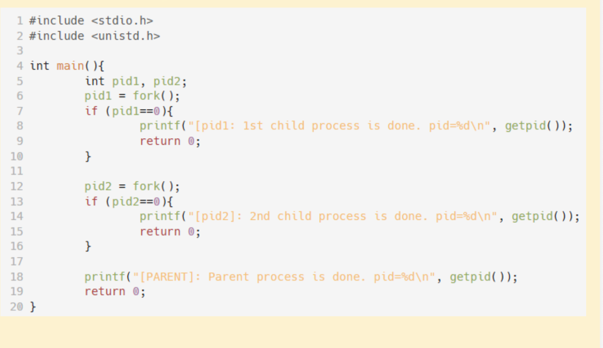
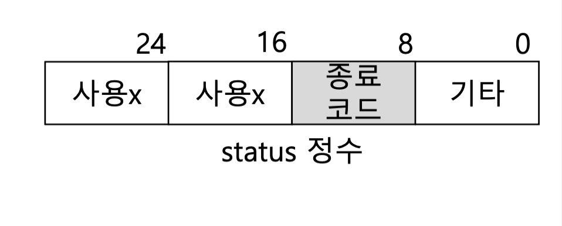

fork() 함수

- 부모 쪽에서는 자식프로세스 pid 리턴 
- 자식 프로세스에서는 0 리턴 

이런 코드일시  프로세스가 종료되는 순서 까지는 정의하지 않았기 때문에 종료되는 순서는 os의 상황에 따라 달라질수있음 

## wait() 함수 

• 끝난 자식 프로세스의 종료 코드가 status에 저장되며
• status의 8\~15비트에 자식 프로세스 종료 코드 존재
• 리턴값: 끝난 자식 프로세스의 번호

