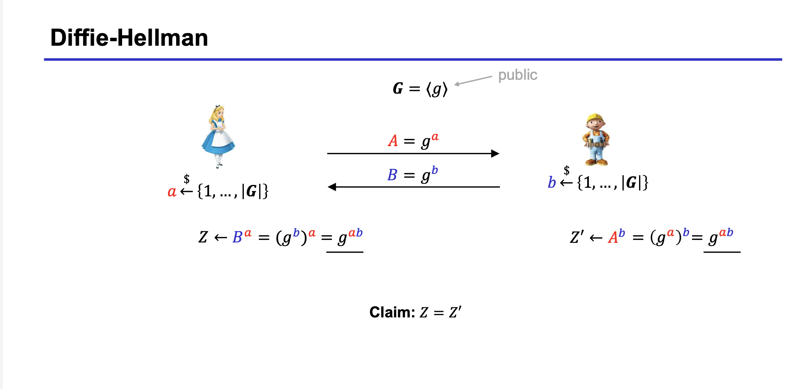

Ek ( 공개 ) 

- 어렵게 만듬 

 Ed ( 비공개 )

Filed (체) 

>  +,-,\*,/ 가 되는것들의 집합 

group( 군)

> ( G , \* ) 연산의 추상화  + , - 사용 항등원 역원 성립  ( 대부분 유한집합) 

( Zp^x, \* ) ( p:prime) 

ring ( 환) 

>

Diffie-Hellman 

Alice : small a 뽑고 large A 구해서 bob 에게 던져줌 

bob : small b 뽑고 large B 구해서 bob 에게 던져줌

alice : (a,B)  , bob : (b,A) 

(DH assumption)

> (공식)

(DLOG assumption)

> (공식)

Diffie hellman 이만족할라면 dh, dlog 문제가 만족해야함 

- dlog/cdh/ddh

cdh가 ddh 보다 더 어려움 

DDH <= CDH <= DLOG 어려움순
