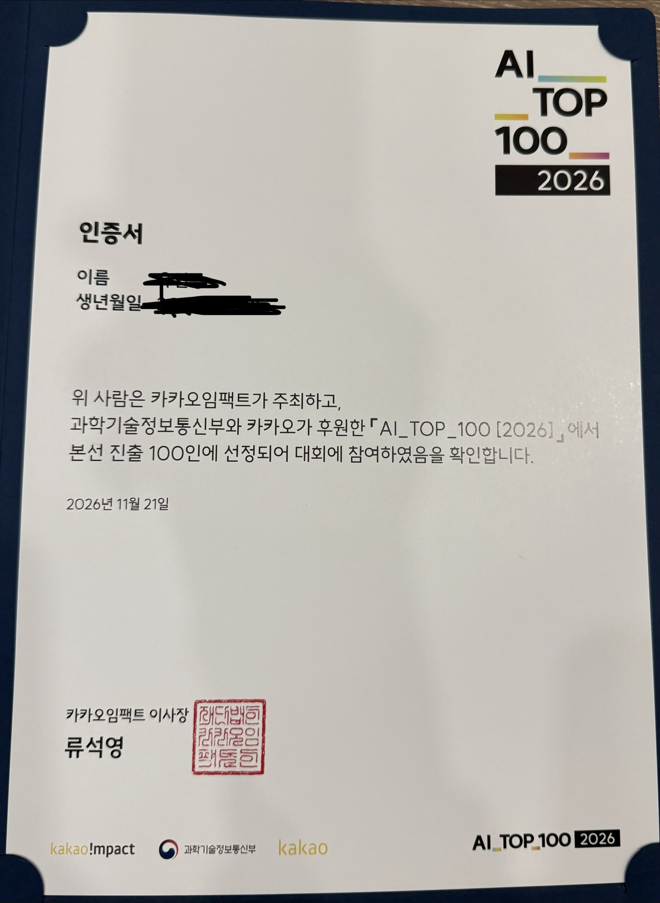

# AI TOP 100 2026 본선 후기

## 어떤 대회였나

카카오 AI TOP 100은 유튜브를 보다가 알게 돼 큰 기대 없이 신청한 대회였다. 그런데 예선을 통과해 본선까지 가게 됐다. 예선은 '교동마을 산지직송'이라는 가상의 쇼핑몰에서 고객 문의에 답하는 응대 에이전트를 만드는 문제였다.

본선 현장에 가 보니 개발을 전공하지 않은 사람들이 대부분인 것 같았고, 직업도 나이도 다양한 사람들이 와 있었다

본선은 세계관만 같고 완전히 다른 문제였다. 제주 바닷가 마을을 3D 가상 월드로 만들어 두고, 거기에 내 에이전트를 MCP로 연결해 마을 사람들의 부탁(퀘스트)을 해결하게 하는 방식이었다. 캐릭터를 내가 직접 조종할 수는 없다. 에이전트가 주변 사진을 보고, 방향을 돌리고, 몇 초 동안 걷거나 뛰고, 말을 걸면서만 움직인다.

## 예선 기준으로 한 준비는 쓸모가 없었다

예선이 챗봇이었으니 본선도 비슷하게 문서를 읽고 답하는 문제일 거라고 생각했다. 그래서 지식 문서를 정리하고 검색을 붙이는 쪽으로 준비했다. 막상 가 보니 본선은 공간을 돌아다니는 게임에 가까웠고, 준비한 건 쓸모가 거의 없었다. 예선 때 만든 지식 문서는 대회 후반에 질문형 퀘스트 몇 개에서 겨우 써먹은 정도였다.

## 3라운드 구성

본선은 총 3라운드로 진행됐다.

- **1라운드 (90분):** 전부 핸즈온. 사람이 에이전트에 마음대로 지시하고 코드를 고칠 수 있다.
- **2라운드 (90분):** 앞 30분은 핸즈오프, 뒤 60분은 핸즈온. 월드가 넓어지고 새 퀘스트가 열린다.
- **3라운드 (90분):** 전부 핸즈오프. 사람은 손을 떼고 관전 화면만 볼 수 있다.

결국 마지막 라운드는 에이전트가 혼자 돌아야 해서, 앞 라운드에서 "혼자서도 잘 움직이는 에이전트"를 만들어 두는 게 핵심이었다.

## 첫 라운드에서 문제 파악을 제대로 못 했다

첫 라운드 때 문제를 제대로 파악하지 못했다. 규칙과 월드 설명을 대충 읽고 AI한테 대충 던져 주기만 했는데, 지금 생각하면 이게 가장 큰 패인이었다. 다시 생각해 보면 왜 그랬나 싶다.

1라운드 동안 한 일을 돌아보면, 정작 퀘스트를 어떻게 풀지보다 주변 환경을 만지는 데 시간을 많이 썼다. 토큰이 떨어질 때를 대비한 API 키 스크립트를 만들고, 관전 화면을 캡처해 에이전트 입력으로 쓰는 방법을 시도했다. 터미널이 꺼져도 돌아가는 백그라운드 실행기와 상태를 보는 관리자 웹 페이지도 만들었다. 하나하나는 그럴듯했지만, 이 게임에서 제일 어려운 게 무엇인지는 모르는 채로 만든 것들이었다.

## 근시안적인 선택이 쌓여 삽질이 됐다

그 나비효과가 2라운드 핸즈오프에서 터졌다. 사람이 손을 뗀 30분 동안 에이전트는 계속 움직였는데, 끝낸 퀘스트는 거의 없었다. 목적지까지 직선으로 걷다가 밭 돌담이나 대문 기둥, 울타리에 막히고, 막히면 다시 생각하고, 또 막히기를 반복했다. 한번은 농가 마당 돌담 구석에 갇혀서, 관전 화면을 보던 내가 "돌담을 따라 쭉 달려서 사선으로 나가 봐"라고 직접 알려 주고 나서야 대문을 찾아 빠져나왔다.

그 뒤로는 계속 땜질이었다.

- 실제로 걸어 본 길만 이어 붙여 경로를 찾게 했다.
- 막히면 뒤로 조금 물러나서 사방 사진을 찍고 열린 쪽을 고르게 했다.
- 막힐 확률을 계산해서 위험할 때만 둘러보게 했다.
- 차도를 우선으로 다니게 했다.
- 한 번 들어간 건물의 문 좌표를 기억하게 했다.

막히는 비율은 많이 줄었지만, 전부 문제가 터진 다음에 하나씩 덮은 대응이었다. 처음부터 방향을 잡았으면 안 해도 됐을 삽질이었다.

## 지도를 그렸어야 했다

돌이켜 보면 무작정 이동할 게 아니라, 먼저 지도를 그리고 그 위에서 BFS로 길을 찾아 움직였으면 훨씬 효율적이었을 것 같다.

지도는 2차원 배열 형태의 격자로 만들면 됐을 것이다. 재료는 이미 충분했다. 이 월드는 이동 명령(move)을 보낼 때마다 응답에 이런 정보를 같이 돌려줬다.

- 막혀서 멈췄는지(`blocked`)
- 무엇에 닿았는지(`touched`). 예를 들면 밭 돌담, 대문 기둥, 울타리, 화분처럼 닿은 대상의 종류와 이름이 같이 왔다.
- 실제로 걸은 거리와 멈춘 위치 좌표

따로 물어볼 필요도 없이 이동할 때마다 공짜로 오는 정보였다. 특히 막히지 않고 벽을 따라 미끄러지며 지나간 경우에도 `touched`에 그 벽이 찍혀서, "이 근처에 이 벽이 있다"는 사실이 이동할 때마다 쌓였다. 그러니 막힌 칸은 장애물로, 실제로 지나간 칸은 길로 격자에 칠해 나가기만 하면 됐다. 게다가 닿은 대상마다 고유한 이름이 붙어 있어서, 같은 담에 막힌 지점들을 모으면 그 담이 어디서 어디까지 이어지는지도 추정할 수 있었을 것이다.

다만 이 응답은 멈춘 내 위치와 닿은 대상의 이름까지만 알려 주고, 벽의 정확한 위치나 미끄러지며 지나간 경로는 알려 주지 않는다. 그래서 벽 칸은 "멈춘 위치에서 진행 방향 바로 앞"으로 추정해서 칠하고, 지도를 정확하게 만들려면 이동을 짧게 끊어 가야 했을 것이다.

사진은 그다음 보조 수단으로 쓰면 됐다. 카메라가 하나라 사진만으로는 거리를 정확히 알기 어렵고, 낮은 돌담은 사진에 잘 안 보이기도 했다. 그래서 매 프레임 사진으로 지도를 그리기보다는, 막혔을 때나 처음 가는 곳에서 사방을 찍어 장애물과 길을 구분하고 지도의 빈 곳을 채우는 데 쓰는 게 현실적이었을 것 같다. 그렇게 지도가 쌓이면 한 번 간 길은 좌표 계산만으로, 지도만 보고 다시 갈 수 있었을 것이다.

지형만 담을 게 아니라 통합된 지도였으면 더 좋았을 것 같다. NPC, 건물 입구, 아이템, 드론 승강장 같은 위치도 같이 기록해 두면, 같은 대상을 다시 찾아다니는 비용이 크게 줄어든다. 실제로 오늘 가장 시간을 많이 잡아먹은 게 "어디 있는지 모르는 대상을 찾아 헤매는 것"과 "아는 곳을 다시 가다 막히는 것"이었는데, 둘 다 지도 하나로 해결됐을 문제였다.

나는 비슷한 걸 2라운드 후반에야 따로따로 만들었다. 길은 "다녀 본 길의 선을 이어 붙이는" 방식으로, 장소는 건물 문과 NPC 좌표를 기억하는 파일로 만들었다. 그런데 길 쪽에서 벽을 따라 미끄러진 이동이 벽을 뚫고 지나간 직선으로 저장되는 버그가 생겨, 오히려 경로가 돌담을 관통하기도 했다. 처음부터 격자 하나에 지형과 대상을 같이 담는 지도로 시작했다면 생기지 않았을 문제였다.

## 결국 문제 정의가 가장 중요했다

결국 처음부터 문제를 제대로 정의하고 방향을 생각했어야 했다. 이 대회의 핵심은 퀘스트 내용을 이해하는 것보다 이 공간을 안 막히고 돌아다니는 것이었다. 그걸 첫 30분 안에 알아챘다면 1라운드를 통째로 이동과 지도 만드는 데 썼을 것이다. 그랬다면 남은 라운드는 퀘스트에만 집중할 수 있었을 것 같다.

특히 앞으로는 주어진 API, 즉 MCP부터 분석해야겠다. 위에 쓴 것처럼 이동할 때마다 지도의 재료가 응답에 이미 다 들어 있었는데, 나는 그걸 대회가 거의 끝나서야 제대로 봤다. 도구마다 어떤 인자를 받고 무엇을 돌려주는지만 처음에 확인했어도 방향이 완전히 달랐을 것이다. 왜 MCP의 인자와 리턴값을 확인하지 않았을까. 후회한다.

돌이켜 보면 예선 때는 API 문서가 따로 페이지로 정리돼 있어서 꼼꼼히 읽고 분석했다. 그런데 본선의 MCP처럼 문서가 따로 없고 직접 불러 봐야 무엇이 오는지 알 수 있는 경우에는, 내가 직접 열어 보고 분석하지 않고 AI에게 맡겨 버렸다. 앞으로는 문서가 있든 없든, 주어진 도구는 먼저 직접 호출해 보고 인자와 리턴값을 정리하는 것부터 시작하는 습관을 들여야겠다.

역시 문제 해결은 문제를 잘 이해하는 게 가장 중요하다는 걸 다시 느꼈다.

## 토큰은 걱정했던 것보다 넉넉했다

의외로 걱정했던 토큰 사용량 부족 문제는 없었다. 대회 내내 에이전트를 계속 돌렸고, 혹시 몰라 구독 한도가 오면 API 키로 넘어가는 장치까지 만들어 뒀다. 그런데 결국 한 번도 넘어가지 않았다. Claude Max로도 충분했다.

## AI만 쓰다 보니

요즘 손코딩을 하지 않고 AI만 쓰다 보니 문제 해결력이 떨어진 느낌이 드는데, 이번 결과에도 그 영향이 있었던 것 같다.

이번에도 코드는 거의 AI가 짰고, 나는 지시하고 결과를 보고 다시 지시하는 역할이었다. 속도는 빨랐지만 문제 구조를 내 머릿속으로 그려 보는 시간이 없었다. "지도를 그리고 BFS로 간다" 같은 건 손으로 짜 봤다면 제일 먼저 떠올렸을 기본기였다. 그런데 "막히는 거 고쳐 줘"라고만 하니 증상만 하나씩 덮는 코드가 쌓였다. 실전 직전에야 드러난 버그도 있었다. 맥 기본 bash에서 안 되는 문법, 변수 바로 뒤에 한글을 붙여서 생긴 오류, `08`을 8진수로 읽는 산술 오류 같은 것들이다. 대부분 AI가 빨리 붙인 코드를 내가 충분히 읽지 않아서 생긴 문제였다.

## 게임 에이전트 방식을 모방했다면?

만약 OpenAI나 Claude의 게임 에이전트 방식을 모방했다면 쉽게 풀 수 있었을까? 그게 궁금하다. 대회가 끝나고 나서야, 게임을 하는 에이전트들은 보통 기억과 길 찾기를 모델 바깥에 따로 두고 모델에게는 판단만 맡긴다는 걸 떠올렸다. 내가 3라운드 직전에야 겨우 비슷하게 만든 구조가 이미 정석처럼 있었던 셈이다. 다음에는 처음부터 이런 사례를 찾아보고 시작해야겠다.

## 마무리

그래도 마지막 라운드에서 에이전트가 90분 동안 사람 손 없이 끊기지 않고 돌아간 건 다행이었다. 중간에 마라톤 공지가 뜨자 에이전트가 스스로 남은 시간을 계산해서 출발 시각에 맞춰 출발선으로 가고, 끝까지 완주하는 걸 관전 화면으로 지켜본 순간은 재밌었다

대회는 재미있었고 창의적이었다. 챗봇 대회인 줄 알고 갔는데 사실상 로봇 길 찾기와 게임 에이전트 대회에 가까웠고, 그 낙차가 당황스러우면서도 즐거웠다. 첫 대외활동이자 첫 대회였는데 좋은 경험이었다고 생각한다.

 카카오의 다음 AI TOP 100 대회도 기대되고, 다음 대회에는 제대로 해 볼 생각이다.

그동안은 공부하면서 실력을 다듬어야겠다. 백준도 다시 살아 났으니, PS를 하면서 예전처럼 사고력을 좀 길러야겠다는 생각이 든다. 적어도 AI가 짠 코드를 내가 이해하고, 문제를 내가 먼저 정의한 다음에 AI를 쓰는 습관을 들이고 싶다.

한 줄로 정리하면, 너무 생각 없이 했다. 경험은 많이 됐지만 좀 후회된다.
